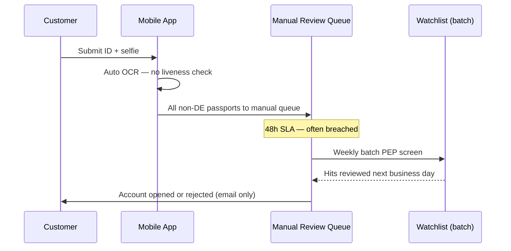
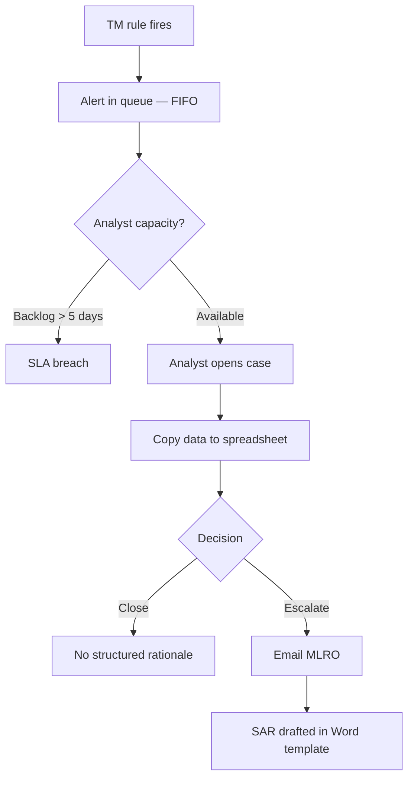

# As-Is Process Analysis — KYC Onboarding & Alert Investigation

## 1. Customer Onboarding (Current State)

## 2. Alert Investigation (Current State)

## 3. Pain Points

| ID | Issue | Business Impact |
|----|-------|-----------------|
| PP-K01 | PEP screening batched weekly | Exposure window up to 7 days |
| PP-K02 | No liveness detection | Synthetic identity fraud risk |
| PP-K03 | Alert investigation offline | No audit trail; regulator challenge |
| PP-K04 | Inconsistent EDD triggers | Some high-risk customers fast-tracked |
| PP-K05 | SAR narrative quality varies | Rework and filing delays |

## 4. To-Be Vision (Summary)

- Real-time sanctions/PEP at onboarding and daily refresh.
- Risk scoring routes customers to straight-through, enhanced, or reject paths.
- Integrated case management with mandatory disposition codes.
- MLRO dashboard for SAR pipeline and regulatory deadlines.

See [BRD](03-business-requirements-document.md) for detailed requirements.
