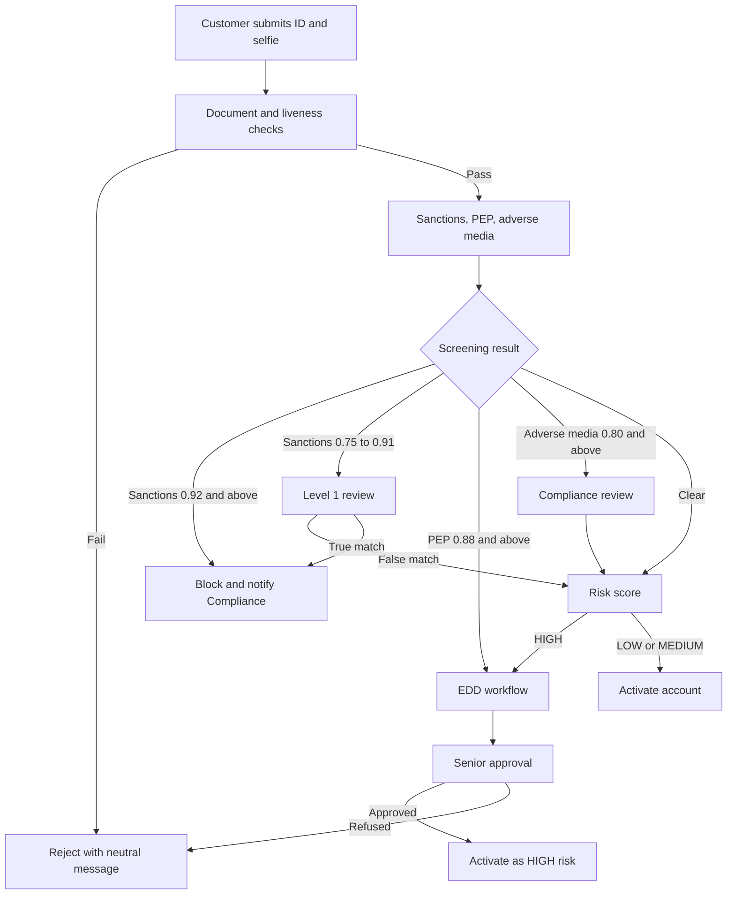
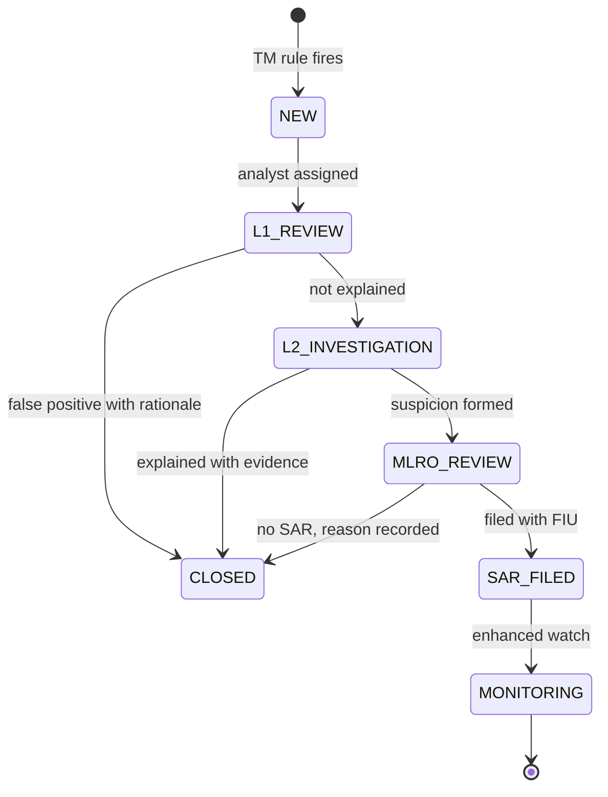

# To-Be Process Design: Helix KYC Modernization

Extends the [BRD](03-business-requirements-document.md). The approved BRD stays as the baseline; the change requests below record gaps found during requirements review. Regulatory points are working assumptions, to be confirmed by Compliance for each jurisdiction.

## 1. Requirements Review Findings

| ID | Finding | Evidence | Resolution |
|----|---------|----------|------------|
| F-01 | Nothing prevents tipping off. A customer can be contacted, or a CRM updated, while a SAR is in progress (AMLD4 Article 39) | US-AML-01, FR-08 | CR-01 adds an information barrier |
| F-02 | Screening matches below the action thresholds have no defined handling, so a score of 0.91 against a sanctions list clears silently | BR-KYC-02 | CR-02 adds a review band |
| F-03 | Rules only describe blocking at onboarding. A daily rescreen hit on an existing customer is undefined | BR-KYC-02 vs FR-01 | CR-03 adds freeze and report |
| F-04 | 5-year retention has no start point. The period runs from the end of the business relationship | FR-02 | CR-04 restates it |
| F-05 | FR-03 requires a risk rating with no method to calculate it | BRD section 2 | CR-05 adds a scoring model |
| F-06 | PEP tiers 1 and 2 are referenced but never defined, and former PEPs are not addressed | US-KYC-03 | CR-06 defines tiers |
| F-07 | A SAR window of 24 to 72 hours is shown as typical, but the duty is generally to report promptly, with timing set nationally | Domain Overview section 6 | CR-07 uses per-jurisdiction configuration |

## 2. Change Requests

| CR | Rule or Requirement | Statement |
|----|---------------------|-----------|
| CR-01 | BR-AML-01 | Once a case is escalated to the MLRO, the existence of a SAR SHALL be visible only to the financial crime role group. Customer-facing messages SHALL use neutral wording. FR-08 webhooks SHALL NOT carry SAR or alert data. |
| CR-02 | BR-KYC-02 (amended) | Sanctions scores from 0.75 to 0.91 SHALL open a Level 1 review before activation. |
| CR-03 | BR-KYC-04 | A confirmed sanctions match on an existing customer SHALL freeze the accounts immediately and start reporting to the competent authority. |
| CR-04 | FR-02 (amended) | Records SHALL be retained for 5 years from the end of the relationship, or the date of an occasional transaction, then deleted unless a legal hold applies. |
| CR-05 | BR-KYC-05 | Customer risk rating SHALL use the model in section 3. |
| CR-06 | BR-KYC-06 | PEP tier 1 is the person holding the function; tier 2 is a family member or close associate. PEP status continues for at least 12 months after leaving the function, and for as long as risk remains. |
| CR-07 | FR-09 (Must) | SAR deadlines SHALL be held as dated configuration per jurisdiction. |

## 3. Customer Risk Rating Model (BR-KYC-05)

| Factor | Value | Points |
|--------|-------|--------|
| Geography | Tier 1 / Tier 2 / Tier 3 | 0 / 15 / 40 |
| Onboarding channel | Remote / assisted | 10 / 0 |
| Expected monthly turnover | Under EUR 5K / 5K to 20K / over 20K | 0 / 10 / 25 |
| Occupation | Standard / cash-intensive | 0 / 20 |
| Adverse media | None / cleared after review | 0 / 10 |

| Total | Rating | Periodic review |
|-------|--------|-----------------|
| 0 to 25 | LOW | Every 5 years |
| 26 to 49 | MEDIUM | Every 3 years |
| 50 and above | HIGH | Annually |

**Overrides** apply regardless of points: PEP or Tier 3 residence gives HIGH.

## 4. To-Be Onboarding Flow

## 5. Alert to SAR Flow

## 6. EDD Checklist

| Item | Evidence | Applies to |
|------|----------|------------|
| Source of funds | Bank statements, sale contract, payslips | All EDD |
| Source of wealth | Tax records, business ownership | PEP tier 1 and 2 |
| Purpose of account | Customer statement checked against profile | All EDD |
| Senior management approval | Named approver, timestamp, rationale | PEP, Tier 3 |
| Enhanced monitoring flag | Sent to TM engine | All EDD |
